# M1.6 visual concepts, evaluation and recommendation

_Status: **approved by ADR-0013** (2026-11-17); **implemented (M1.6, 2026-11-18)**; the owner chose the recommended synthesis (§5) and accepted D2–D10 as written (§6). Prototypes:
`experiments/e5-visual-concepts/` (run instructions in `README.md`). Every
screenshot below is from those prototypes in headless Chrome at 1440×900, with real
repository content (`crates/exec/src/executor.rs`, real `cargo test` output
shapes). Surfaces from later milestones (agent, environments) use mock data
labelled **MOCK · M2/M3** on screen._

---

## 1. Audit of the current shell

### 1.1 Status of M1.5

M1.5 is **closed by owner waiver**, not by passing its gate. The Tauri shell is the
only shell (the Qt shell was retired on 2026-11-17, tag `qt-shell-final`), and every
budget is met on Linux. What is still open, because there was no hardware and no CI
budget: macOS/Windows budgets, the manual protocol (IME, screen readers, HiDPI,
drag and drop), and the T-12 gate (`docs/roadmap/current.md`). For M1.6 this means:

- The redesign targets the Tauri shell only (there is nothing else to redesign).
- **Any M1.6 criterion that needs macOS or Windows inherits the same blocker.**
  M1.6-QA-005 carries it explicitly and cannot be marked tested without real hosts
  or a CI run.

### 1.2 Frontend architecture today

| Layer | Implementation | Keep? |
|-------|----------------|-------|
| Host | `src-tauri/` (Rust): daemon bridge, 11 host commands, geometry, close interception, crash snapshots | Untouched by M1.6, except window-chrome config if D3 is approved |
| State | `src/state/*`: external stores (`workspace`, `documents`, `tasks`, `settings`) via `useSyncExternalStore` | Untouched; M1.6 reads them only |
| Daemon client | `src/daemon/*`, generated wire types | Untouched |
| Editor | Monaco 0.57 via `editor/src` shared modules; theme generated from CSS tokens (`src/editor/surface.ts`) | Theme generator extended to syntax tokens |
| Views | `App.tsx` (433 lines: layout, menus, shortcuts, palette commands) + 8 components | Restyled and split (see `frontend-architecture.md`) |
| Design system | `tokens.css` (3 layers, 2 themes), `app.css` (824 lines, BEM-ish), `ui/primitives.tsx` (Radix Dialog + DropdownMenu, hand-rolled Splitter/Segmented), `ui/icons.tsx` (18 hand-drawn icons) | Replaced in place; same file roles |
| Guards | `tests/tokens.test.ts`: no literal colours, both themes define every token, 6 AA pairs | Extended |

It is a small, disciplined codebase (about 4.9k lines of TS/CSS) with no
component-framework debt. The redesign needs **no architectural change**: it can
be done by rewriting tokens and styles and restructuring a few views.

### 1.3 Visual and interaction weaknesses (current shell)

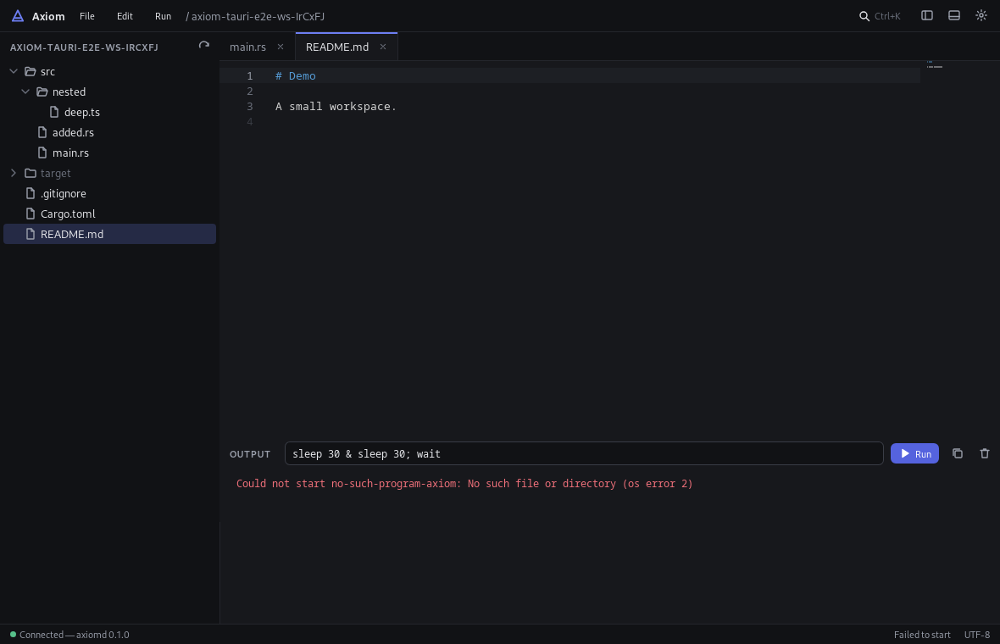

1. **One surface tone everywhere.** Sidebar, editor and panel are all `#17181c`/`#111215`;
   regions are separated only by hairlines, so nothing establishes hierarchy.
2. **Generic palette.** A cool Linear-style grey plus a stock indigo accent. Nothing about it says Axiom.
3. **No material language.** Buttons, inputs, panels and content look alike, so you cannot tell what is pressable or editable.
4. **Machine state is text.** "Connected — axiomd 0.1.0" and task status are small grey strings in the status bar. A running task is not visible from across the screen.
5. **Stderr is painted red.** `cargo` writes its progress ("Compiling", "Finished") to stderr, so a healthy build looks like a failure.
6. **The console's command field is a 30 px input across the full width with a purple Run button.** It dominates the panel.
7. **The tab strip follows VS Code** (top accent bar, close icons always visible).
8. **The title bar wastes its centre.** Menus are rendered as quiet buttons, and the palette affordance is a faint "Ctrl+K".
9. **Motion is fades only** (80/160 ms). Panels and the sidebar pop in and out; tabs jump; nothing conveys continuity.
10. **Type is unmanaged.** Inter and JetBrains Mono are named but not bundled, so every machine renders a different fallback (the screenshot shows a system sans).
11. **No discoverability layer.** Shortcuts exist but are only shown in menus and the palette.

---

## 2. Three directions

All three share the same product requirements, data, components and behaviour
(`experiments/e5-visual-concepts/src/shared.tsx`). They differ in **topology,
material, palette, type and motion**, so the comparison is between visual languages,
not between feature sets.

### Concept A — Precision Workstation ("Graphite & Brass")

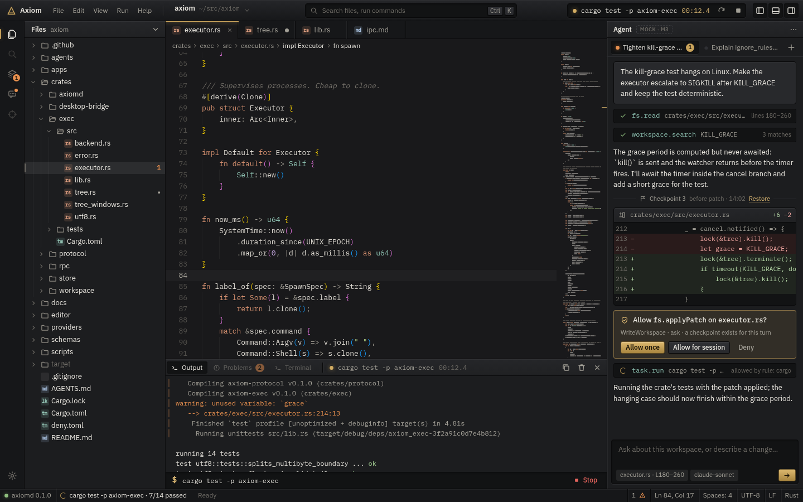
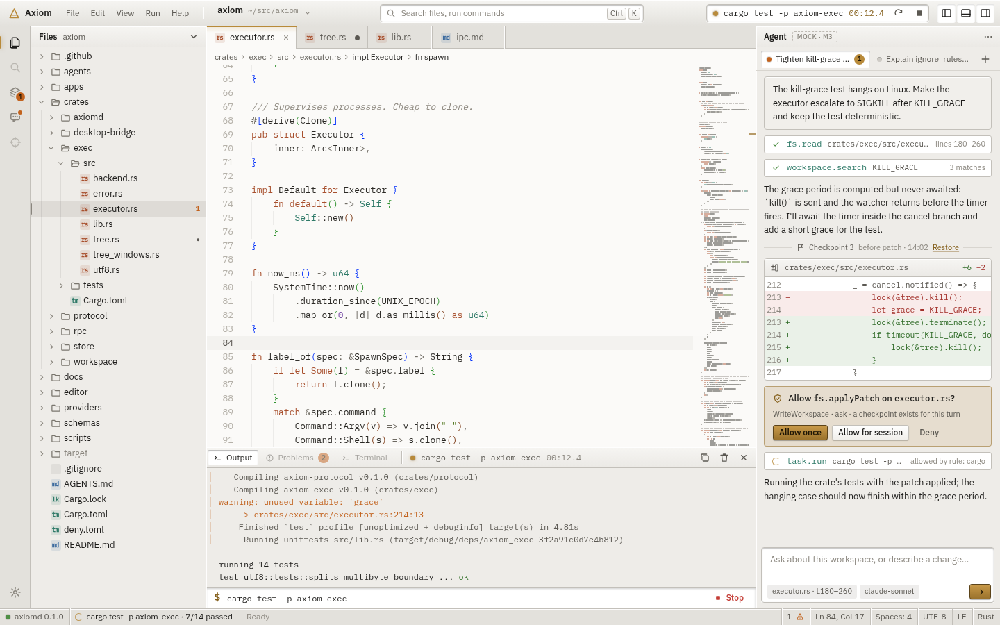

**Rationale.** Graphite is borrowed from machined instruments: warm-neutral dark
greys, joints drawn as a dark seam plus a lit edge, and one brass signal colour.
The layout is the conventional IDE topology executed with precision: title row with
command field and task transport, activity rail, explorer, editor, console and
agent dock.

| Token | Dark | Light ("Aluminium") |
|-------|------|------|
| canvas / chrome / panel / editor | `#0e0f10` / `#161719` / `#1c1d1f` / `#19191b` | `#bebbb5` / `#e3e1dc` / `#eeece8` / `#fbfaf8` |
| text / muted / faint | `#e6e3dc` / `#a3a097` / `#6f6c66` | `#1e1d1b` / `#5b5852` / `#8a867e` |
| accent (brass) | `#c9a35b`, text `#d9b672` | fill `#b88a3a`, text `#85601c` |
| ok / run / warn / danger | `#8fbf7f` / brass / `#e8904f` / `#e5645d` | `#4f8f45` / brass / `#c2621d` / `#c43c35` |
| syntax | keyword clay `#d18e6e`, type verdigris `#8ec2b2`, string olive `#a9c47f`, number lilac `#c4a7de`, macro steel `#9fb8d8` | darker equivalents |

- **Type:** IBM Plex Sans 13/12/11 px; IBM Plex Mono 13/20 for code; sentence-case headers, 12 px semibold.
- **Surfaces:** five tiers (canvas, chrome, panel, editor, overlay); every boundary is a seam plus a lit edge; header strips use a 2-stop gradient.
- **Icons:** 16 px stroke at 1.35 with square-ish terminals; file types as small monospaced glyph chips (`rs`, `md`, `tm`).
- **Motion:** precise, 90/140/200 ms, ease-out with no overshoot, 8 px travel.
- **Accessibility:** text 13.7:1, muted 6.7:1, accent text 9.1:1, on-accent 7.8:1. Warning text in light is only 4.0:1.
- **Complexity:** medium; mostly CSS. **Performance:** see §4.

**Strengths.** Calm, dense, unmistakably "tool"; brass is rare in IDEs and reads as
quality rather than marketing; lowest learning cost.
**Weaknesses.** The bevel on *every* joint is the skeuomorphism the research warns
about (`research.md` §9.2), and it starts to look busy at panel boundaries. The
topology is close to the IDE default, so identity rests on palette and material.
Tonal steps between editor and panels are too small (`#19191b` vs `#1c1d1f`).

### Concept B — Creative Instrument ("Slate & Signal")

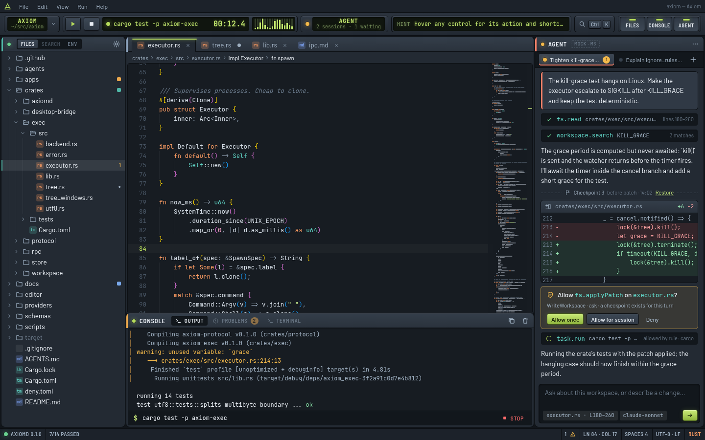
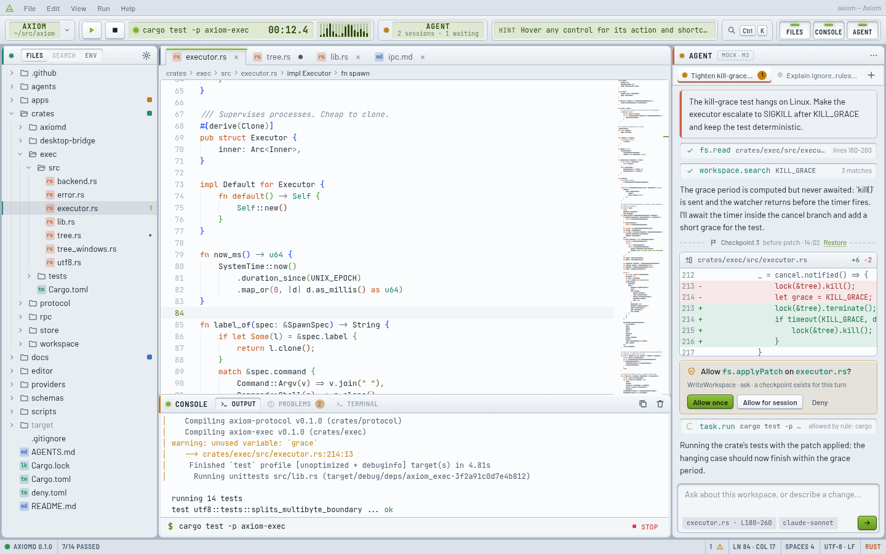

**Rationale.** The closest translation of a music workstation. A transport bar of
recessed **LCD modules** (workspace, task with time and an output-rate meter, agent,
and a live **hint display**); panels are **rack modules** with a colour identity
strip, LED and condensed caps label; toggles are **LED buttons**; folders can carry
user colour tags (FL pattern colours, adapted).

| Token | Dark | Light ("Daylight") |
|-------|------|------|
| canvas / panel / editor well | `#11151a` / `#232a33` / `#171c22` | `#a8b3c0` / `#e8edf2` / `#fbfcfd` |
| text / muted | `#e8edf3` / `#9fb0c1` | `#16202b` / `#4b5a6a` |
| accent (signal lime) | `#b6dc5c` | `#7db22e`, text `#4c7a0e` |
| region hues | files teal, console amber, agent coral, env sky | darker |
| LCD | `#10150f` with lime `#c3e86e` text | reflective `#dfe8d2` with olive text |

- **Type:** Barlow 13.5 for UI; Barlow Semi Condensed 600 caps (+0.07em tracking) for every label; JetBrains Mono 12.5/19.
- **Surfaces:** a rack with 3 px gaps; module headers use gradients; the editor and console are inset wells.
- **Motion:** lively, 100/170/240 ms with overshoot (`cubic-bezier(.3,1.35,.5,1)`) on pops and toggles.
- **Accessibility:** text 14.6:1, muted 7.7:1. In light, warning text is 3.2:1 (fails) and the accent 5.0:1. All-caps condensed labels hurt legibility and screen-reader pronunciation (caps are CSS only, which is fine for SR, but sustained reading of caps is slower).
- **Complexity:** high. Many bespoke components; colour tags need persistence (shell-local); the LCD needs its own legible light variant.

**Strengths.** The most distinctive and the most "alive". Machine state is
excellent: task, time, output rate, agent and hints are all readable from a
distance. It is the strongest expression of FL Studio's craft.
**Weaknesses.** 72 px of top chrome. Five region hues plus lime plus syntax colours
compete with code (research principle 4). Caps everywhere is tiring over eight
hours. It reads as a DAW, not an IDE, and risks the "FL clone" judgement. It has the
highest idle cost of the three (§4).

### Concept C — Modern Technical Studio ("Ink & Cinnabar")

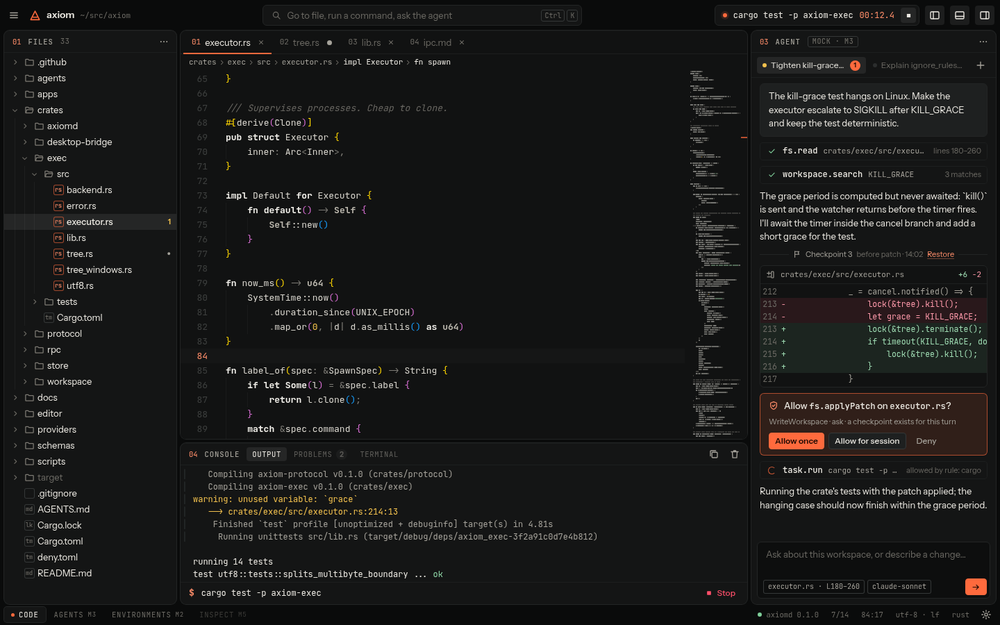
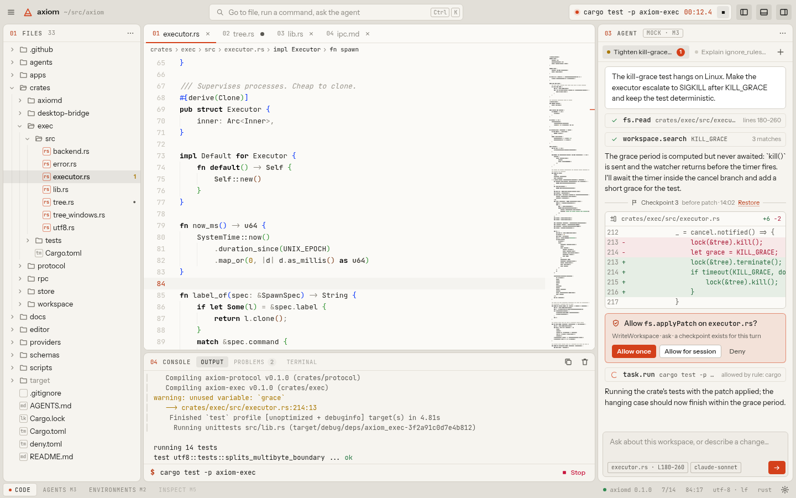

**Rationale.** Industrial-design studio rather than instrument: matte tiles float on
an ink canvas with even 6 px gutters, captions are monospaced and numbered
(`01 FILES`, `04 CONSOLE`), a Resolve-style **page bar** at the bottom switches
whole workspaces (Code / Agents / Environments / Inspect), and syntax highlighting
is deliberately sparse: keywords carry **weight** (bold, near-white), and only
strings, numbers and macros carry hue. Paper is a first-class light theme.

| Token | Dark | Light ("Paper") |
|-------|------|------|
| canvas / tile / editor | `#0a0b0b` / `#141515` / `#111212` | `#e2dfd8` / `#f6f4ef` / `#fbfaf7` |
| text / muted | `#edeae3` / `#a6a39b` | `#1a1a18` / `#5a5852` |
| accent (cinnabar) | `#ff6a3d` | `#d4401a`, white text 4.6:1 |
| danger | `#ff4f6a` (**close to the accent**) | `#c8143c` |

- **Type:** Instrument Sans 13; JetBrains Mono 10.5 caps for captions and 13/21 for code.
- **Surfaces:** two tones plus gutters; no gradients or bevels; one popover shadow.
- **Motion:** editorial, 120/180/260 ms with symmetric curves and crossfades.
- **Accessibility:** text 15.6:1. However, **accent and danger are both red-orange**, so "focused/primary" and "error" are separated only by hue nuance; this fails "never by colour alone" unless every error also carries a glyph. Mono captions at 10.5 px are at the edge of legibility.
- **Complexity:** low to medium. **Performance:** cheapest (§4).

**Strengths.** Quietest and most contemporary; looks least like any IDE; excellent
light theme; cheapest to render.
**Weaknesses.** Gutters cost about 18 px horizontally and 12 px vertically. The
accent/danger collision is a structural flaw. Sparse syntax is divisive (a setting at
best). The page bar has one real page in M1 (research §2.5 argues against it for
IDEs). Tactility is weak: the brief's FL-craft goal is the least served.

---

## 3. Weighted evaluation

Scores 1–10, by the design session from the prototypes and measurements. The
owner may re-weight.

| Criterion | Weight | A | B | C | Notes |
|-----------|-------:|--:|--:|--:|-------|
| Distinctive visual identity | 20% | 7 | 9 | 8 | A's identity is palette and material; B is unmistakable but DAW-like; C is novel but restrained |
| Visual craftsmanship and polish | 20% | 8 | 7 | 8 | B's density of effects reads as busy at 1×; A and C are cleaner |
| Usability and information hierarchy | 20% | 9 | 6 | 7 | B: 72 px of chrome, colour noise, caps; C: gutters, accent ≈ danger |
| Interaction and animation quality | 15% | 7 | 9 | 7 | B's LEDs, meter, hint LCD and pressed keys are the strongest feedback |
| Performance and responsiveness | 15% | 8 | 6 | 9 | Measured idle cost with the running indicators: A 18%, B 24%, C 9% of a core (software raster, §4) |
| Accessibility and maintainability | 10% | 8 | 5 | 6 | B: caps plus 5 region hues plus an LCD light variant; C: accent/danger collision |
| **Weighted total** | | **7.85** | **7.40** | **7.60** | |

No concept wins outright. A has the best foundation, B the best signals, and C
the right structural restraint. Each one's weakest point is another one's strength.

---

## 4. Measured cost of each concept

From `experiments/e5-visual-concepts/scripts/{perf,idle-cpu,idle-isolate}.mjs`,
headless Chrome 1440×900, software raster, Fedora 44 reference machine, 3 repetitions.
These numbers are **indicative**: production runs on WebKitGTK/WKWebView/WebView2
and is re-measured by M1.6-QA-002 and QA-004 on the real app.

| Metric | R | A | B | C |
|--------|--:|--:|--:|--:|
| Palette open/close, frame interval p95 / max (ms) | 16.7 / 16.8 | 16.7 / 16.8 | 16.7 / 16.8 | 16.8 / 16.8 |
| Sidebar toggle (2×), p95 / max | 16.8 / 16.8 | 16.7 / 16.8 | 16.8 / 16.8 | 16.7 / 16.8 |
| Tab switch ×4, p95 / max | 16.8 / 16.8 | 16.7 / 16.8 | 16.8 / 16.8 | 16.8 / 16.8 |
| Splitter drag (40 moves), p95 / max | 16.8 / 16.8 | 16.7 / 16.8 | 16.7 / 16.8 | 16.8 / 16.8 |
| Frames > 20 ms during all motions | 0 | 0 | 0 | 0 |
| Typing in Monaco: keydown → 2nd frame start, p50 / p95 | 24.5 / 32.6 | 25.3 / 32.1 | 22.2 / 32.5 | 24.3 / 32.4 |
| Idle main-thread task time, running indicators on | 0.44% | 0.47% | 0.34% | 0.29% |
| **Idle whole-browser CPU, running indicators on** | **18%** | **18%** | **24%** | **9%** |
| Idle whole-browser CPU, reduced motion | ≈0% | ≈0% | ≈0% | ≈0% |

What this shows:

- All shell motions held 60 Hz with zero long frames in every concept. Motion as
  designed (transform/opacity, single layout commit) is not a risk.
- Typing measures the same in all four. The redesign does not touch the typing path.
  The metric spans one full frame by construction, so read it as "no difference",
  not as an absolute latency.
- **Looping indicators are the risk.** Main-thread time is negligible, but
  raster/compositor work is not: the "task running" indicators cost 9–24% of a core in
  software raster. Isolation on R: spinners ≈ 9%, smooth LED breathing ≈ 6–8%, the
  same LED with `steps(6)` ≈ 1.6%, activity sweep ≈ 2–5%, caret blink (1 Hz,
  stepped) ≈ 0. The **looping-animation policy** in `motion-system.md` §5 (stepped
  loops at ≤ 8 updates/s, at most one per region, paused when the window is
  hidden) measured **4.4%** with everything running, and reduced motion is ≈0%.
  The production budget is set in `performance.md` §3.

---

## 5. Recommendation: "Precision Instrument" (A + B's signals + C's restraint)

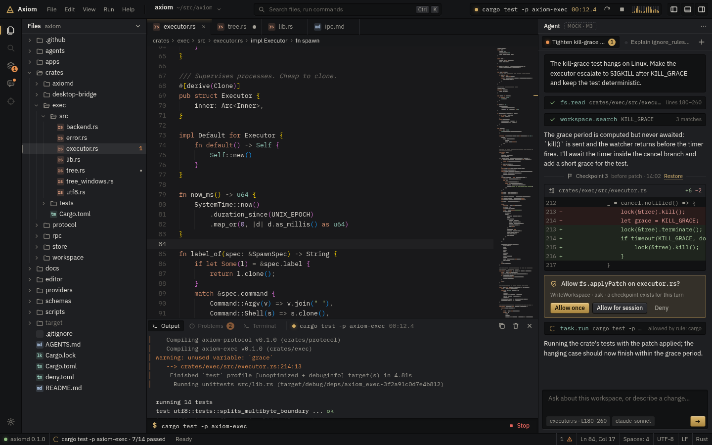
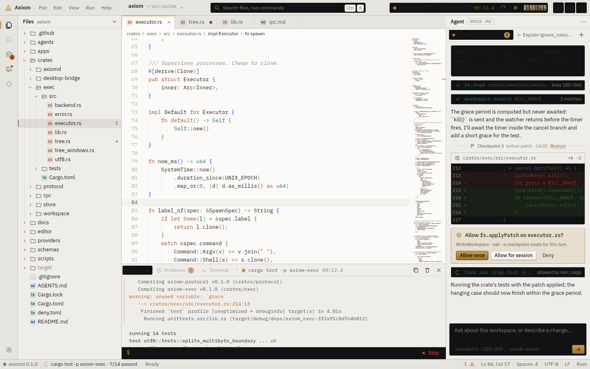

Concept A is the base, adjusted by the strongest evidence from the other two:

| Take | From | Why |
|------|------|-----|
| Graphite and brass palette, IBM Plex type, density, conventional topology | A | Highest usability score; brass is distinctive without being loud |
| **Material grammar**: raised = pressable, recessed = holds a value or accepts input, flat = content and structure | A + C + research | Keeps tactility where it means something; removes bevels from structure (the research's top anti-pattern) |
| Tone and hairlines for structure; the editor is the deepest well | C, research §9.1.5 | Stronger hierarchy than A's near-equal tones, with no gutter cost |
| Task **transport** with LED, elapsed time, **output-rate meter**, rerun and stop | B | Machine state readable at a glance (principle 4) |
| **Hint line** with keycaps in the status bar | B (FL hint bar), Blender | Discoverability without tooltips covering content |
| Pressed-in engaged toggles; LEDs for backend, task and attention | B | Tactile, legible state |
| Stepped looping policy; Standard/Reduced/Off motion setting | Measurements, FL | Idle CPU 18% → 4.4% (prototype) |
| Not taken: region hues, caps labels, LCD bezels (B); gutters, page bar, sparse syntax, red accent (C) | | Noise, chrome height, legibility, semantic collision |

Recommended-direction screens (more in `concepts/`):

| | |
|-|-|
| 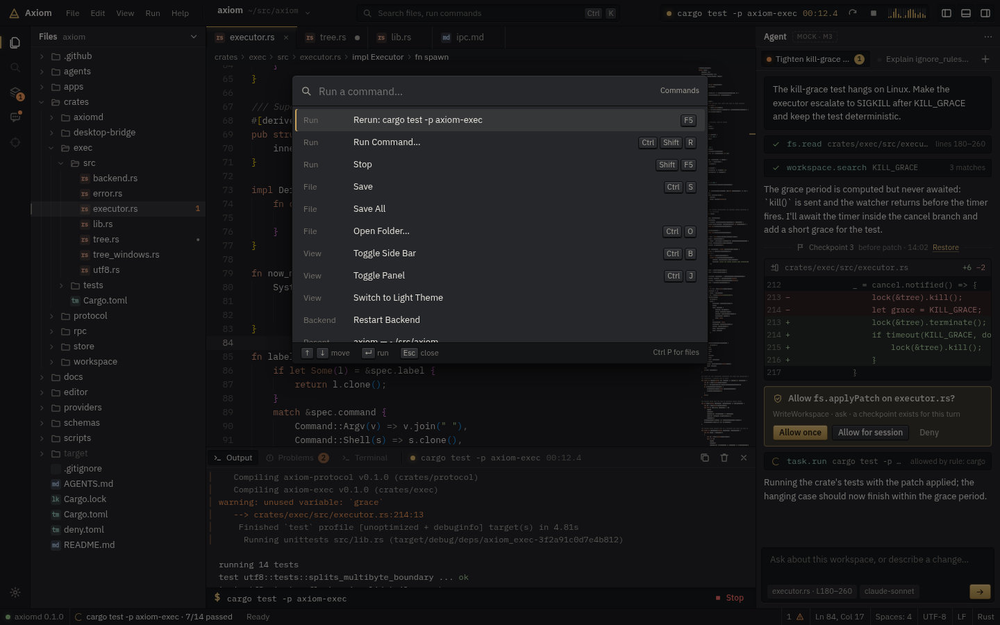 Command palette | 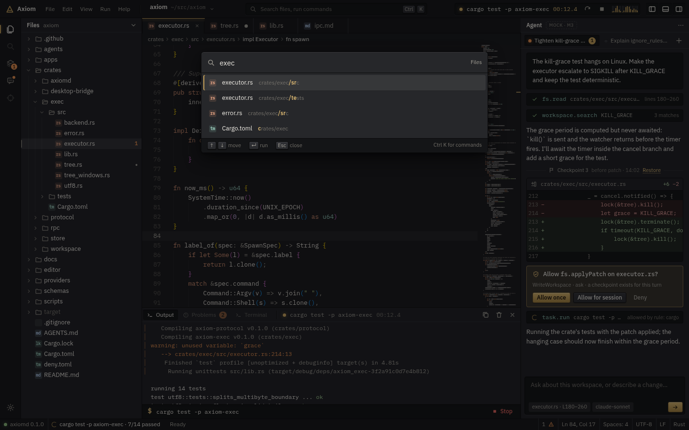 Go to file |
| 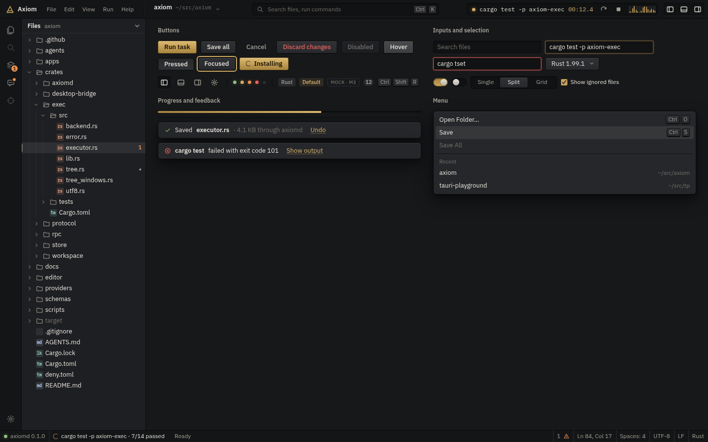 Controls in every state |  Hint line (hovering Rerun) |
| 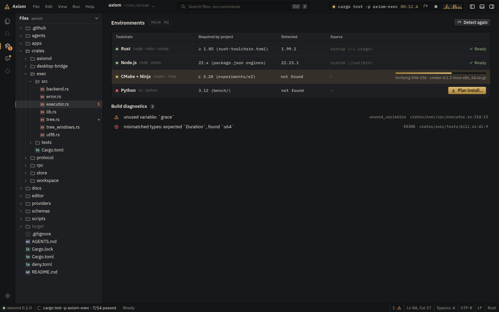 Environment Manager (M2 mock) | 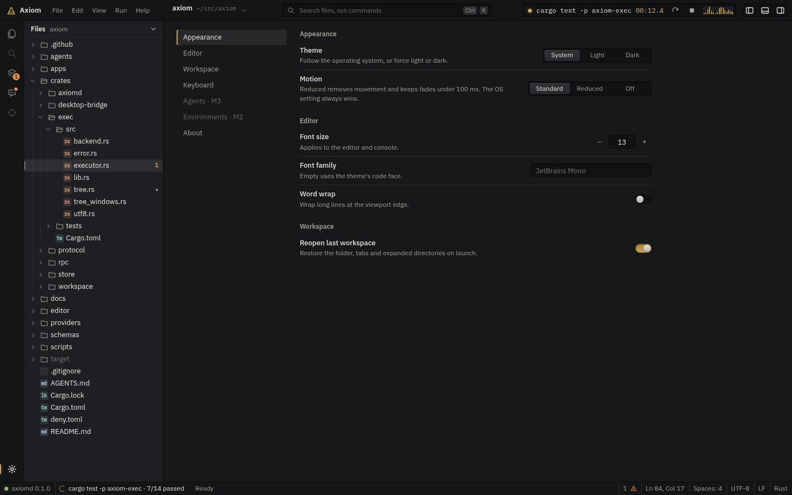 Settings |

2× detail: 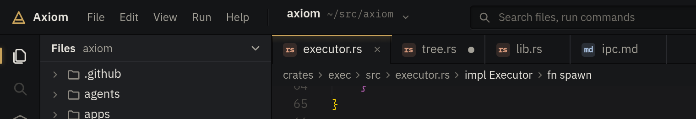 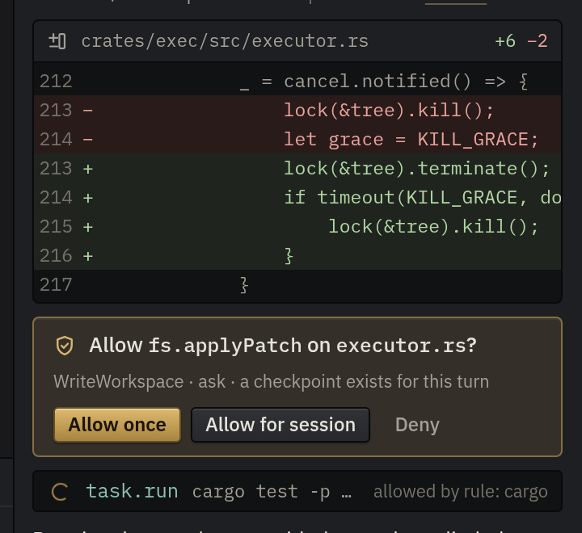

It scores as A on usability and accessibility, takes B's interaction score, and gets
A's performance with the looping policy applied. The design system
(`design-system.md`) is written for this direction. If the owner picks another
concept, those documents are re-derived in M1.6-DESIGN-001 before any
implementation.

It supports M2–M7 without a redesign. The rail gains destinations (Environments
M2, Agents M3, Search/Git M4, Inspect M5, Debug M6). The dock hosts the AI
workspace (M3) and the inspector (M5). The transport generalises to builds and
debug sessions. The console gains Problems (M2) and Terminal (M4). The token
generator is ready for user theming (M7). See `workspace-spec.md` §5.

---

## 6. Decisions requiring the owner's approval

**Decided 2026-11-17 (ADR-0013):** D1 = the recommended synthesis; D2–D10 accepted
as recommended below. Refinement in D2: Plex's licence reserves the name "Plex", so the
bundled files are IBM's own unmodified split subsets, not locally subset fonts
(ADR-0013 §6).

| # | Decision | Recommendation | Alternatives |
|---|----------|----------------|--------------|
| **D1** | Visual direction | **Recommended synthesis ("Precision Instrument")** | A, B or C as prototyped; a different combination |
| **D2** | Bundle typefaces | **Bundle IBM Plex Sans (400/500/600) + IBM Plex Mono (400/500), Latin subset WOFF2, about 180 kB, OFL-1.1.** Needs an ADR-0011 note that OFL fonts are allowed as assets. Caveat: Zed's bundled UI face is also IBM Plex, so identity must not rest on the typeface. | System fonts (no cost, but inconsistent per OS, as today); Inter + JetBrains Mono bundled |
| **D3** | Window chrome | **macOS: overlay title bar (traffic lights inset into our title row). Windows/Linux: keep native decorations in M1.6, with the native title bar themed dark/light from the setting.** A custom-drawn frame on Windows/Linux is deferred: it loses Windows 11 Snap Layouts and GNOME/KDE conventions, and needs its own accessibility work. | Native everywhere (adds a ~30 px OS bar on macOS too); custom frame everywhere (highest risk) |
| **D4** | Activity rail before M2 | **No rail in M1.6.** The rail appears when a second real destination exists (Environments, M2). Before that, the side bar header names the view (no placeholder UI). | Ship the rail with only Files (an empty control) |
| **D5** | Motion setting | **Add `appearance.motion` = `standard`/`reduced`/`off`** (shell-side unknown settings key, which needs no protocol change; the OS reduced-motion setting always wins) | Follow the OS only |
| **D6** | Stderr presentation | **Stop painting stderr red.** Mark it with a gutter glyph, muted colour and the visually-hidden "stderr:" prefix (already present); only failure status lines use the danger colour. M1 exit criterion 7 ("distinctly") still holds. | Keep red |
| **D7** | Tab reordering by drag | **Include in M1.6** as INTERACTION-004 (shell-local tab order, already persisted by `saveTabState`) | Defer to M4 editor UX |
| **D8** | Tooltip primitive | **Adopt `@radix-ui/react-tooltip` (MIT)**: icon-button names must be reachable by keyboard, which `title` is not | Keep `title` attributes |
| **D9** | Delivery | **Restyle in place, task by task, on `task/<id>` branches, merged in dependency order.** No dual-design feature flag (that would be dead code). The guard test and screenshot baselines catch regressions. | A `design=v2` flag until the end of the milestone |
| **D10** | Light theme | **Ship both themes with equal care**; light warning text darkened to ≥ 4.5:1 (currently 4.0:1 in A) | Dark only in M1.6 |

The approval is recorded by **M1.6-DESIGN-001** (ADR-0013 "Visual identity and
material grammar"). Until then, no production code changes.

## Deviations at exit (M1.6-QA-006, 2026-11-18)

Where the shipped shell differs from this document, `design-system.md`, `workspace-spec.md` or the
reference screenshots. Each is recorded in its task's handoff; owner decisions are quoted in
`docs/roadmap/verification/M1.6.md`.

| Area | Specified | Shipped | Why / owner |
|------|-----------|---------|-------------|
| Transport elapsed time | tenths (00:12.4) | mm:ss, 1 s steps | the loop policy forbids a faster timer (SHELL-003) |
| Status bar | EOL and language segments | omitted | the documents store exposes neither; no store change in M1.6 (SHELL-005) |
| Console header meta | while a task runs | also the last command and its outcome afterwards | matches the transport (SHELL-006) |
| Editor tabs | title ellipsis 220 px | tab max 260 px, title 220 px; close slot 24 px, right padding 3 px | room for glyph and close; 24 px target (EDITOR-001, QA-003) |
| `--accent-line` | translucent brass (55 %) | solid `--accent` wherever a hairline or focus ring uses it | the legacy alias shadowed the token from SYSTEM-001 on, so every approved screenshot shows solid brass; kept pixel-identical at removal (QA-006) |
| Light state text | `--danger` `#c23a34`, `--ok-text` `#3e7935`, `--warn` `#a8520f`, `--accent-text` `#85601c` | `#bc342e`, `#397330`, `#a44e07`, `#845f1b` | ≥ 4.5:1 on chrome too (QA-003, D-A11Y-2; owner: "fix the defects you can") |
| Light primary button | gradient `--accent-hi` → `--accent-lo` | `--accent-hi` → `--accent` | text contrast 4.15 → ≥ 5.8 (QA-003, D-A11Y-1) |
| Target sizes | (not specified) | transport and console buttons, tab close ≥ 24 px; explorer rows stay 22 px | WCAG 2.5.8; rows waived by the owner ("waive it") |
| Leaving the editor with Tab | — | Ctrl+M (Ctrl+Shift+M on macOS), Monaco's own toggle, documented | D-A11Y-3 |
| Title row | fixed layout | shrink order: workspace path → command field → task label / workspace name; ≤ 860 px hides the brand word and the task label | it overflowed the window (macOS session, `ea76324`) |
| macOS title bar | 72 px inset | 86 px inset, traffic lights centred on the 38 px row, inset dropped in full screen; drag and double-click zoom enabled | measured on the owner's Mac (`7ffbae9`, `faea29e`, `59daa58`) |
| Region motion | entrance on show | no entrance on the first render (startup) | INTERACTION-002 |
| Loop gate | pause loops while unfocused | pauses only the two loops (spinner, LED) | pausing everything froze entrances at opacity 0 (found on macOS) |
| Palette files, no match | — | "No matching files" / "Only files listed in the explorer are searched" | SURFACES-001 |
| Settings | font size 8–40 (old sheet) | 8–32; Licences link to the public repository | spec range; no bundled licence page (SURFACES-002) |
| macOS rendering | WebKit's 60 Hz cap | display refresh rate via WebKit private SPI (`macos_frame_rate.rs`) | owner-approved ("Yes.. I approved it") |
