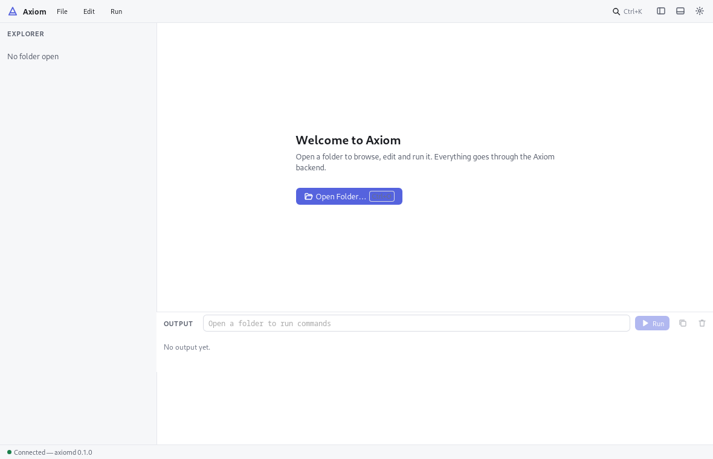
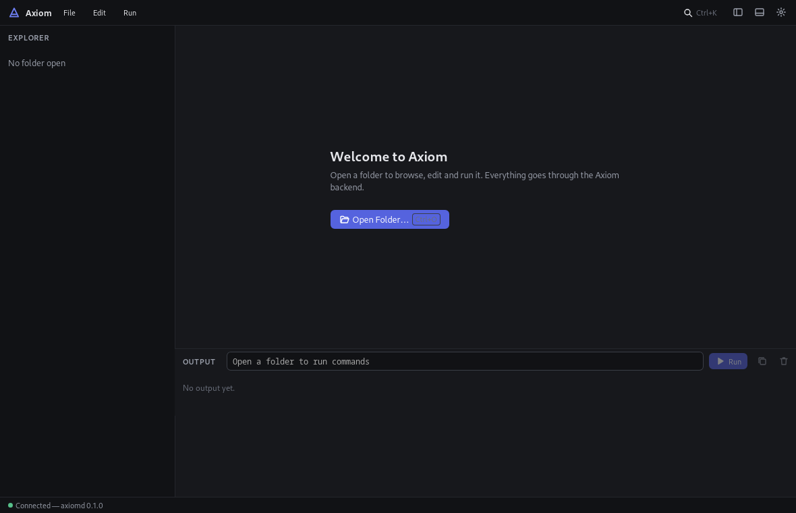
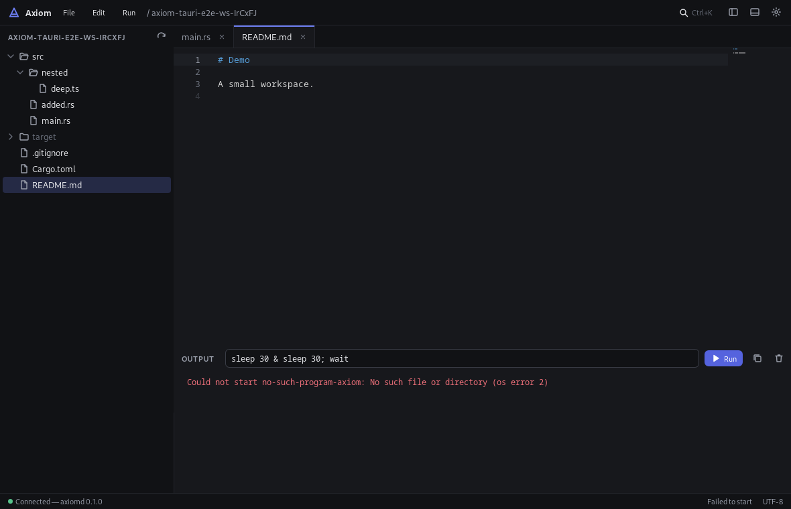
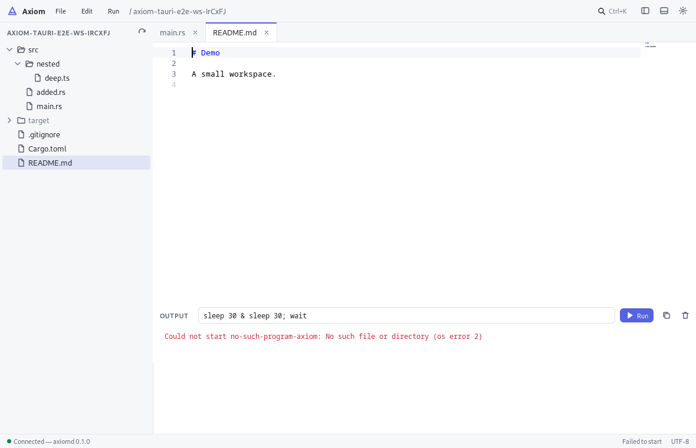
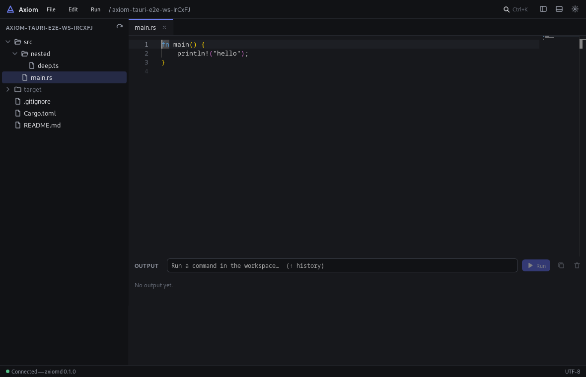
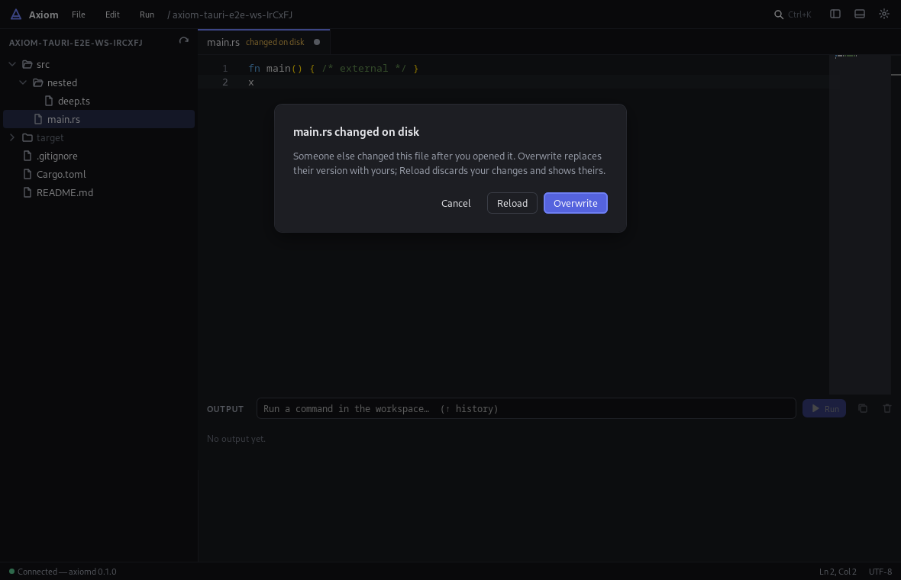
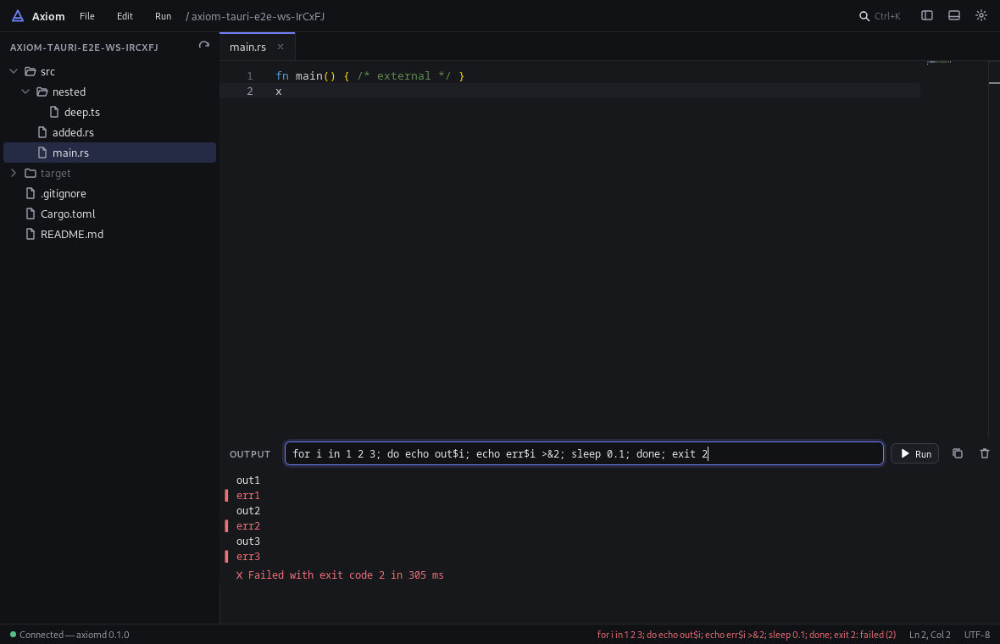
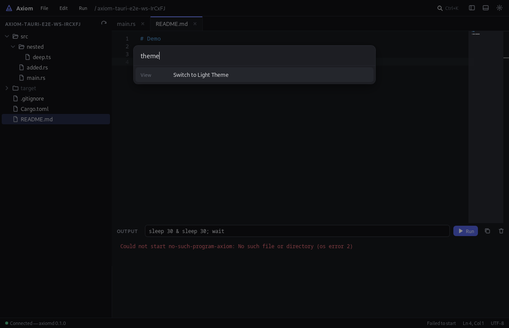

# Qt → Tauri: prototype plan and results

_Status: prototype **built and run** (Phase 4). Location:
`apps/desktop-tauri/` — isolated: its own Cargo workspace (not a member of
the root workspace), its own pnpm package; `apps/desktop/`, `editor/`,
`crates/` and `scripts/check.sh` are untouched._

## 1. Scope (from the brief)

| # | Demonstration | Built | Verified by |
|---|---------------|-------|-------------|
| 1 | Launch and daemon connection | ✅ | E2E 1; bridge tests |
| 2 | Opening a workspace | ✅ (dialog via `tauri-plugin-dialog`; E2E uses the same store call) | E2E 2 |
| 3 | Navigating the file explorer | ✅ (lazy, virtualised, keyboard) | E2E 3a/3b; stores tests |
| 4 | Opening and editing files in Monaco | ✅ (Monaco 0.57.0, shared `editor/src/documents.ts`) | E2E 4a/4b (real key events) |
| 5 | Saving through the daemon | ✅ (Ctrl+S inside Monaco → `fs/writeFile` with `expectedVersion`) | E2E 5 (bytes compared on disk) |
| 6 | External file modifications | ✅ (clean reload, dirty → badge → conflict dialog, explorer refresh) | E2E 6a/6b/6c |
| 7 | Running commands with streamed output | ✅ (stdout/stderr, status, Stop, spawn errors) | E2E 7a/7b/7c |
| 8 | Restoring application state | ✅ (last workspace, expanded dirs, tabs, active tab, settings, history, geometry, panel sizes) | E2E 8 (full process restart) |
| 9 | Light and dark themes | ✅ (shell + generated Monaco themes) | E2E 9; screenshots |
| 10 | Polished, Linear-inspired UI | ✅ (design-system.md) | screenshots below; token guard tests |

Out of scope by design: renderer-crash recovery (designed, not built — gap
E-12), macOS/Windows runs, packaging/signing, M2+ features.

## 2. Layout

```
apps/desktop-tauri/
  Cargo.toml              isolated workspace: bridge + src-tauri
  bridge/                 axiom-desktop-bridge (Rust, no GUI deps)  + tests/bridge.rs (12 tests, real axiomd)
  src-tauri/              Tauri host: 7 commands, capability, CSP, geometry, close interception
  src/
    daemon/               DaemonClient (TS), Tauri transport, wire types
    state/                stores ported from the Qt models (workspace, documents, tasks, settings)
    editor/surface.ts     Monaco + shared editor/src logic behind the bridge-1 interfaces
    components/, ui/      React views and design-system primitives
    styles/               tokens.css (all colours), app.css
  tests/                  Vitest: stores vs real axiomd (13), token guards (3)
  e2e/                    WebDriver smoke test of the real app (tauri-driver → WebKitWebDriver)
  bench/                  Qt-vs-Tauri harness (run.py, daemon_tap.py, results/)
  scripts/                env.sh, sysroot.sh (no-sudo WebKitGTK headers), headless.sh, e2e.sh
```

## 3. Reuse

| Reused unchanged | How |
|------------------|-----|
| `axiomd` and every service crate | spawned exactly like the Qt shell does |
| Protocol 0.1 types | `axiom-protocol` is a dependency of the bridge (envelope parsing, method registry) |
| `editor/src/documents.ts` (bridge-1 dirty tracking, saves, throttling) | imported via the `@editor` alias — one implementation for both shells |
| `editor/src/monaco-setup.ts`, `bridge.ts`, `version.ts` | same |
| Behaviour specs (data-flow, ipc, editor-bridge) | the stores are line-by-line ports of the Qt models' logic |

Nothing in `crates/` or `editor/` was modified.

## 4. How to run (Linux; all GUI runs headless)

```sh
# once, Fedora without sudo: WebKitGTK/GTK dev headers + Xvfb into .toolchains/
apps/desktop-tauri/scripts/sysroot.sh
cargo install tauri-driver --version ^2 --locked

cd apps/desktop-tauri && pnpm install
source scripts/env.sh
cargo test -p axiom-desktop-bridge          # 12 tests (needs: cargo build -p axiomd at the repo root)
pnpm run check && pnpm test                # tsc + 16 Vitest tests (13 against the real daemon)
scripts/e2e.sh                             # builds, then drives the real app on a private Xvfb
bench/run.sh --runs 7 --heavy-runs 3       # Qt vs Tauri (needs build/desktop/axiom)
```
`scripts/headless.sh` (used by `e2e.sh` and `bench/run.sh`) unsets
`WAYLAND_DISPLAY`, forces `GDK_BACKEND=x11` and points `DISPLAY` at a
private Xvfb, so no window ever appears on the developer's desktop; both
scripts refuse to run otherwise.

## 5. Results

### Test results (Fedora 44, x86_64, WebKitGTK 2.54.2, Xvfb)

| Suite | Result | Notes |
|-------|--------|-------|
| `bridge/tests/bridge.rs` | 12/12 pass | includes crash/restart, timeout via SIGSTOP, 200 concurrent requests, ordering |
| `tests/stores.test.ts` | 13/13 pass; **20/20 consecutive runs** | one flake found and fixed during looping: tab order depended on response order when two files were opened in the same tick (the Qt model behaves the same; the test now opens sequentially) |
| `tests/tokens.test.ts` | 3/3 pass | found a real contrast defect (3.5:1) which was fixed |
| `e2e/smoke.mjs` | 15/15 checks pass on 5/5 consecutive runs; after §6 hardening and the Monaco-deferral change, **18/18 on 2/2 runs** | real WebKit, real key events, Ctrl+S inside Monaco, restart restore |

### Defects found while building (all fixed, each with a regression test)

1. **Bridge panicked when called from a Tauri command** (`tokio::spawn`
   outside a runtime → abort). Found by the first E2E run. Fix: the bridge
   owns a runtime handle. Test: `request_forward_from_a_thread_without_a_runtime`.
2. **Enum field casing** (bridge): `serverVersion` serialised as `server_version`.
   Test: `events_serialize_with_camel_case_fields`.
3. **Monaco 0.57 is incompatible with Tauri's `freezePrototype`** (assigns
   to frozen built-ins at load → blank editor). Fix: option disabled;
   recorded as a security trade-off. An error boundary now contains editor
   failures so the shell stays usable.
4. **`cargo build --release` produced a dev-server build** (missing
   `custom-protocol` feature). Fixed as a default feature.
5. **Monaco on the startup critical path** (found by the benchmark, not a
   test): opening a workspace loaded ~4 MB of editor JS before the explorer
   painted, making Tauri no faster than Qt to a usable explorer. Monaco now
   loads only when a document opens; time-to-explorer halved (performance.md §3.1).

### Screenshots (from the E2E run, 1180×760, software rendering)

| | |
|---|---|
|  |  |
|  |  |
|  |  |
|  |  |

For comparison, the Qt shell: `docs/assets/shell-editor.png`,
`shell-explorer.png`, `shell-output-failed.png`.

## 6. Review of the prototype's own evidence

The screenshots exposed two weaknesses in the first version of the E2E test
itself (not the app), which were fixed:
- the conflict screenshot was captured mid-animation (dialog at low
  opacity); the test now waits for the animation and asserts the dialog is
  opaque and holds focus;
- the palette screenshot showed the query empty, raising the question
  whether keystrokes leaked into Monaco; the test now asserts the palette
  input has focus, that filtering selects the expected command, that the
  underlying document did **not** become dirty, and that Enter runs the
  command.

## 7. What the prototype does not prove

- Behaviour on **macOS (WKWebView)** and **Windows (WebView2)**.
- Real GPU rendering (Linux DMABUF/NVIDIA paths), HiDPI, IME, clipboard
  across apps, drag and drop, screen readers.
- Renderer-crash recovery (not implemented).
- Packaging, signing, notarisation, updates.
- The M5 preview/CDP question (architecture.md §4).
